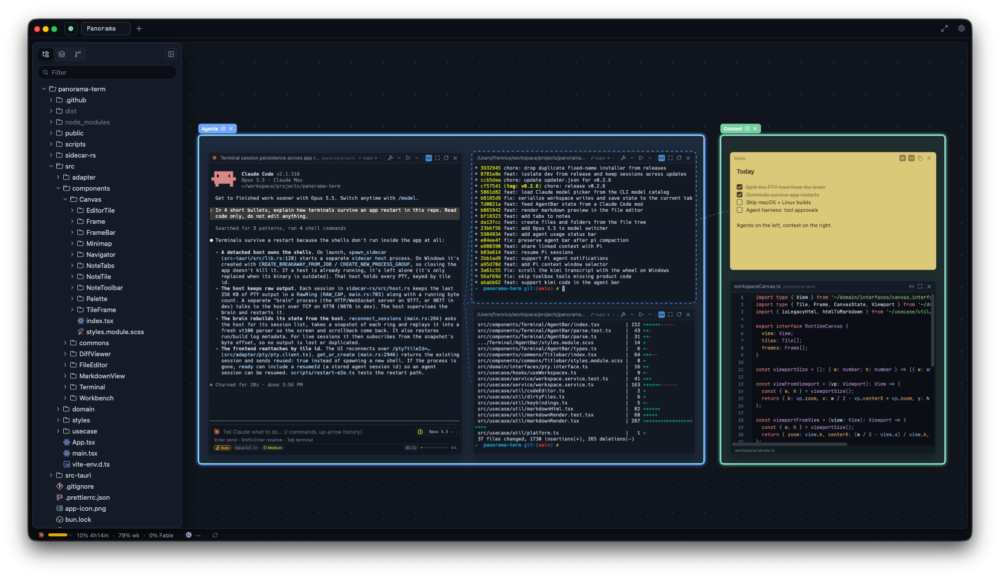
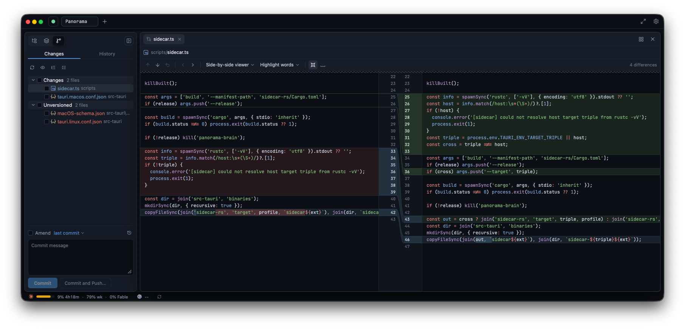

<p align="center">
  
</p>

<h1 align="center">Panorama</h1>

<p align="center">
  An infinite canvas for agentic development. Terminals, notes, code and diffs side by side,<br>
  so your agents and your work live in one place instead of a pile of tabs.
</p>

<p align="center">
  <a href="https://github.com/Frenvius/panorama-term/releases/latest"></a>
  
  
  
  
  
  
  <a href="LICENSE"></a>
</p>

<p align="center">
  <a href="https://github.com/Frenvius/panorama-term/releases/latest"><b>Download</b></a>
</p>



Every terminal is a tile you drag, resize and park wherever it makes sense. The shells run in a
separate native daemon, not in the app, so closing the window, reloading the UI or installing an
update does not kill anything. Reopen and every session is exactly where you left it.

Early stage, moving fast.

## Features

- **Infinite canvas** - pan, zoom and spread out as many live terminals as you need. Tiles snap to
  each other, frames group related tiles so they move together, and the minimap and navigator get
  you back to anything far off screen.
- **Terminals that survive** - sessions live in a native PTY daemon. App restarts, UI reloads and
  updates reattach to the running shells, scrollback included.
- **Built for coding agents** - Claude Code tiles get a floating prompt box with image paste,
  a model and effort picker, usage and cost in the status bar, and a toast when an agent finishes
  in a tile you are not looking at.
- **Linked tiles** - draw a link between tiles and they show up as cords on the canvas. An agent
  in a linked terminal (Claude Code, pi) can message the agents in its linked terminals and read
  their screens, so one agent can hand work to another. A note linked to an agent becomes context
  it can read and edit, so checklists, specs and plans stay in sync with the work.
- **Notes** - markdown sticky notes with checklists, in a palette of colors, linkable to terminals.
- **Code editor** - open any file from the tree in an editor tile or overlay, with syntax
  highlighting, find and Markdown preview.
- **Git built in** - the sidebar has the file tree, branches, staging, commit and history.
- **Diff viewer** - side-by-side or unified, word-level highlights, walk changes with `Alt+Arrow`.
- **Workspaces and tabs** - separate canvases per project, all saved locally.
- **Rebindable shortcuts** - every command lives in Settings > Shortcuts.

### Agent support

Panorama is built around **Claude Code** first, and that is where the integration goes deepest:
live model, effort, context and cost state, the model picker, notifications and linked context all
come from a Panorama mod that runs inside Claude Code. Other agents work too, with less depth: **pi** and
**Kimi Code** get the prompt bar and live status, **Codex**, **OpenCode** and **Antigravity** are
recognized in their tiles, and any other CLI agent runs fine as a plain terminal.



## Getting around

`Mod` is `Ctrl` on Windows and Linux, `Cmd` on macOS.

| Action             | Key                        |
| ------------------ | -------------------------- |
| New terminal       | `Mod+T`                    |
| New note           | `Mod+Shift+N`              |
| Close tile         | `Mod+W`                    |
| Reopen closed tile | `Mod+Shift+T`              |
| Fullscreen tile    | `Mod+Shift+F`              |
| Go to tile         | `Shift` `Shift`            |
| Navigator          | `Mod+B`                    |
| Reset zoom         | `Mod+0`                    |
| Pan / zoom         | Drag canvas / `Mod+wheel`  |

All rebindable in Settings.

## Install

Grab the installer for your platform from the
[latest release](https://github.com/Frenvius/panorama-term/releases/latest). Installed builds update
themselves.

The macOS build is not notarized yet: right-click the app and choose **Open** on first launch.

## Run from source

```sh
bun install
bun run dev
```

Needs Rust and bun. `bun run dev` compiles the Rust PTY daemon, starts it on port 9877, runs Vite,
and opens the Tauri window. An already-running daemon is reused, so a restart reattaches to live
shells instead of respawning them.

Dev builds are isolated from an installed release so both can run at once: ports 9877/9878
(release 9777/9778), their own config directory (`panorama-dev`), runtime files in `~/.panorama-dev`,
and the app identifier `com.frenvius.panorama.dev` (`src-tauri/tauri.dev.conf.json`). The dev binary
is `panorama-dev` so the release installer, which kills `panorama` by name, leaves it alone.

Updates keep live terminals: the PTY host and the brain run from temp copies, the host restarts
the brain when the sidecar binary changes, and the app replaces the host only when its code changed
(`sidecar host-id`).

`bun run build` produces an installer with the daemon bundled alongside the app.

## How it works

The frontend never emulates a terminal. `sidecar-rs` owns the PTYs: `portable-pty` spawns the
shell, `vt100` does the VT emulation, and each tile holds a WebSocket to it that receives a
ready-to-paint grid frame - a line buffer plus packed per-cell attributes. The tile renders that
grid directly, scaled by the zoom level, which is why 20 live terminals on screen stay cheap.
No xterm.js anywhere.

The daemon is split in two: a small host process that holds every PTY and keeps a ring buffer of
recent output per session, and a "brain" that parses it and serves the frontend. The brain can be
rebuilt or restarted and rebuilds its state from the host without losing a byte.

Tiles off screen or shrunk below a minimum width drop their grid and show a placeholder; the
shell behind them keeps running.

Built with Tauri 2, React 19, Vite, SCSS Modules, and bun. Everything is written to local files.

## Sidecar protocol

- `GET /health` -> `ok`
- `GET /kill?tileId=...` -> kill a session and its process tree
- `WS /pty?tileId=...&cols=...&rows=...[&cwd=...][&target=...]`
  - in: `{t:"in",d}` / `{t:"resize",cols,rows}` / `{t:"scroll",rows}` / `{t:"kill"}`
  - out: `{t:"ready",cols,rows,reused}` / `{t:"exit"}`, plus binary grid frames

One session per `tileId`, keyed by the daemon, so a reconnect replays the current screen. Spawns are
throttled by a semaphore so opening a workspace with 30 tiles does not fork 30 shells at once.
